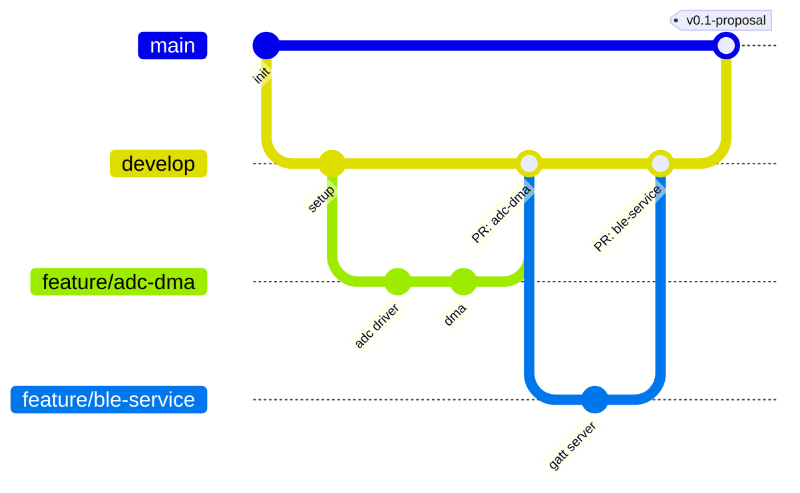

# How to work in this repository

There are two levels. Start with Level 1; move to Level 2 when you and your tutor agree.

| Branch | Purpose |
|---|---|
| `develop` | Day-to-day work. Default branch. |
| `main` | Stable, presentable versions: milestones, deliverables, final version. |
| `feature/<short-description>` | Level 2 only: one branch per task, e.g. `feature/adc-dma`. |

## Setup (once)

1. Install [Git](https://git-scm.com/downloads) and tell it who you are (use your GitHub email):
   ```bash
   git config --global user.name "Your Name"
   git config --global user.email "you@example.com"
   ```
2. Accept the invitation to the repository (GitHub emails it to you).
3. Clone it. The first push opens a browser window to log in to GitHub.
   ```bash
   git clone https://github.com/elb105/<repo>.git
   cd <repo>
   ```

## Level 1: commit and push to `develop` (first weeks)

```bash
git pull                          # start of every session: get the latest changes
# ... work ...
git status                        # check what changed: nothing secret, nothing huge
git add .
git commit -m "Read ADC with DMA" # say what changed
git push
```

That's all. Commit small and often, and push at least once a day: the repository is also your backup.
At milestones your tutor merges `develop` into `main`.

- **Push rejected?** Someone (maybe you, from another computer) pushed first: run `git pull`, then `git push`.
- **Merge conflict?** Ask your tutor the first time.

## Level 2: feature branches and pull requests



Each task follows the same cycle. The `gh` commands need the [GitHub CLI](https://cli.github.com) (`gh auth login` once);
you can also open and merge pull requests on github.com.

```bash
# 1. Start from an up-to-date develop
git switch develop
git pull

# 2. Create a branch for the task
git switch -c feature/adc-dma

# 3. Work and commit as often as you like
git add .
git commit -m "Add ADC driver"

# 4. Push the branch
git push -u origin feature/adc-dma

# 5. Open a pull request into develop
gh pr create --base develop --fill

# 6. Merge it (after your tutor's review, if you asked for one) and delete the branch
gh pr merge --merge --delete-branch

# 7. Update your local develop
git switch develop
git pull --prune
```

### Milestones: `develop` → `main`

```bash
gh pr create --base main --head develop --title "Milestone: thesis proposal"
# your tutor reviews and approves
gh pr merge --merge               # no --delete-branch here: develop stays

git switch main
git pull
git tag -a v0.1-proposal -m "Thesis proposal"
git push origin v0.1-proposal
git switch develop
```

Suggested tags: `v0.1-proposal`, `v0.5-midterm`, `v1.0-submission`, `v1.0-defense`.

Prefer clicking? VS Code's Source Control panel (plus the *GitHub Pull Requests* extension) and GitHub Desktop do all of the above.
